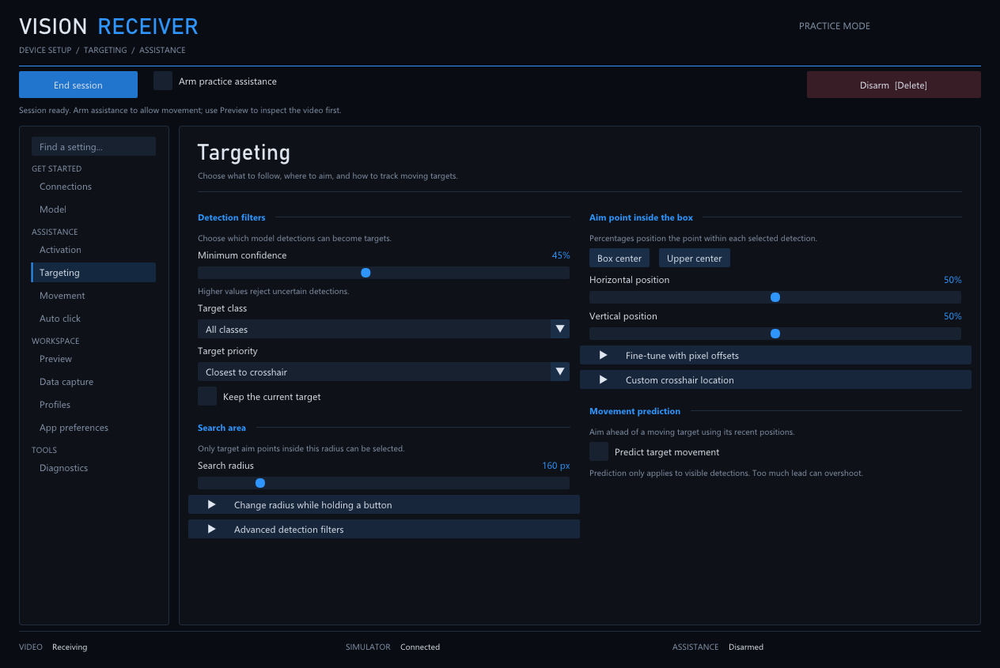

# Receiver

Receiver processes image frames with YOLO models and sends mouse commands to a
Raspberry Pi USB proxy. Windows includes a desktop interface; Linux runs from the
command line.

## Features

- Choose UDP video or local Windows desktop capture with a selectable display.
- Switch models during a session, with automatic image sizing.
- Remember settings for each model and restore saved profiles.
- Adjust detection, tracking and movement while viewing a live preview.
- Prefer a detection class globally or only near the normally selected target.
- Target an HSV color directly, or use color inside a model box to refine aiming.
- Try the interface and run automated checks without a physical device.

## Try it on Windows

1. Download a Windows package from a successful [GitHub Actions run](https://github.com/tyoueenn2/Receiver/actions/workflows/receiver.yml).
2. Extract it, open the app folder, and install Python 3.12 or newer.
3. Double-click **Start Demo.cmd** to try the interface with simulated devices.

The demo starts with movement off and does not move your actual mouse. To use
your own model or connect devices, follow the [getting started guide](docs/GETTING_STARTED.md).

## Documentation

See the [documentation index](docs/README.md) for setup, model runtimes, builds,
protocols, tests and troubleshooting. Downloadable builds support practice mode
and native `.pt` models with the Python runtime installed; ONNX and `.engine`
models require a TensorRT build.

The searchable sidebar separates connections, activation, targeting, movement,
automatic clicking, preview, data capture, profiles and app preferences.
The interface includes continuous tracking, timed auto trigger and spray, configurable
preview overlays, Aimmy config import, model-switch shortcuts, and local frame collection.
See the [feature guide](docs/technical/AIMMY_FEATURES.md) for setup and compatibility.



## Repository layout

```text
docs/           Getting started, technical documentation and licenses
include/        C++ headers
src/            Receiver application and processing code
tools/          Model workers, device simulators and utilities
tests/          Automated checks and test fixtures
models/         Sample model and metadata
profiles/       Example settings
integrations/   Raspberry Pi integration assets
```
